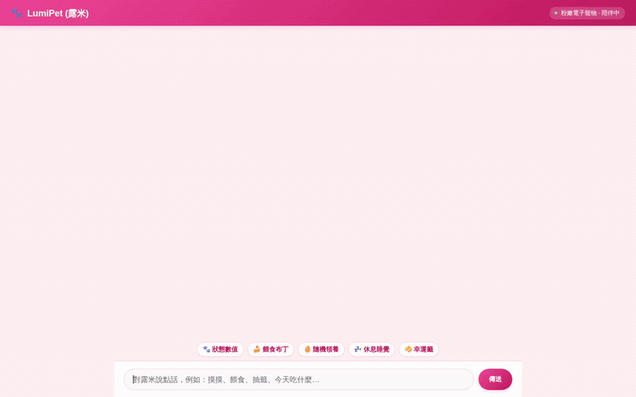

# 🐾 LumiPet (露米) - 辦公桌療癒電子寵物

> An intelligent, comforting virtual desktop companion built with the **Google Agent Development Kit (ADK)** and deployed on **Google Cloud Agent Platform (Agent Runtime)**. Lumi accompanies users during busy workdays with wholesome chit-chat, real-time Firestore pet stats, snack feeding, interactive petting reactions, meal recommendations, and AI-generated milestone snapshots and videos.

<div align="center">



</div>

---

## 🌟 Overview & Capabilities

**LumiPet (露米)** is a desktop virtual pet designed to bring comfort, cheer, and utility to office workers and creators. Powered by Google's latest Gemini models, Lumi interacts with warm empathy, tracks persistent state in Firestore, executes calculations in an Agent Engine Code Sandbox, generates pastel 3D milestone photos and short animation clips, and delivers visual cards via **A2UI (Agent-to-User Interface)**.

### What the Agent Actually Does:
- 🌸 **Live Pet Status & Progression**: Queries live hunger, energy, mood, level, and bond experience points stored in Cloud Firestore (`get_pet_status`).
- 🍰 **Snack & Treat Feeding**: Browses an inventory of snacks from Firestore (`get_treats`) and feeds Lumi (`feed_pet`), restoring fullness, boosting mood, and granting level-up experience.
- 🐾 **Interactive Petting & Playing**: Responds dynamically to actions like headpats (`摸摸`), pokes (`戳戳`), hugs (`抱抱`), and playtime (`陪玩`) with custom animations, bond gains, and mood boosts (`interact_with_pet`).
- 🏪 **Custom Snack Crafting**: Allows users to design and stock new custom treats directly into the Firestore catalog (`add_treat_to_catalog`).
- 🥠 **Daily Wholesome Fortune**: Fetches uplifting life advice from the Advice Slip API, provides a daily lucky snack recommendation, and boosts bonding (`draw_fortune_slip` / `get_daily_wisdom`).
- 🍱 **Meal & Foodie Decision Wheel**: Recommends lunch or dinner dishes based on budget, mood cravings, or a randomized foodie wheel, and discovers nearby restaurants using Google Places API (`recommend_meal`).
- 📸 **AI Milestone Polaroid Snapshot**: Generates 3D pastel milestone photos of Lumi using Google's `gemini-3.1-flash-lite-image` model, saving the image to the Playground Artifacts panel and uploading it to Cloud Storage (`generate_pet_photo`).
- 🎥 **Short Animation Video Generation**: Generates short clips using Google's Omni model (`gemini-omni-flash-preview`), saving the artifact and uploading it to Cloud Storage (`generate_short_video` / `generate_destination_video`).
- 🌤️ **Live Weather & Care Reminders**: Fetches real-time weather and temperature via Open-Meteo API to remind users to dress warmly or bring an umbrella (`get_live_weather`).
- 💱 **Currency Conversion**: Real-time currency conversion using Open Exchange Rates API (`convert_currency`).
- 📍 **Geocoding & Places Discovery**: Converts landmark addresses to geographic coordinates (`geocode_address`) and finds nearby spots (`find_nearby_places`) via Google Maps APIs.
- ⏰ **Timezone Awareness**: Checks current local times across international time zones (`get_current_time`).
- 🧮 **Agent Engine Sandbox Code Execution**: Securely computes exact progression math and stat calculations using `AgentEngineSandboxCodeExecutor`.
- 🧠 **Cross-Session Long-Term Memory**: Proactively recalls user preferences, health notes, dietary restrictions, and allergies across sessions via Vertex AI Memory Bank.

---

## 🧩 Wired Google Cloud Services & Architecture

Based directly on the codebase (`app/agent.py` and `agents-cli-manifest.yaml`), the following Google Cloud services and models are implemented and wired up:

| Layer | Service / Model | Role in LumiPet |
|---|---|---|
| 🤖 **Reasoning Core** | **Google ADK + `gemini-3.8-flash`** | Core agent reasoning loop with automated retries and character prompt engineering. |
| 🧠 **Long-Term Memory** | **Vertex AI Memory Bank** | `PreloadMemoryTool` injects durable user memories at turn start; `after_agent_callback` extracts memories into `VertexAiMemoryBankService`. |
| 🗄️ **Structured Database** | **Cloud Firestore** | Stores pet status records (`pets` collection) and snack items (`treats` collection). |
| 🖼️ **Media Storage** | **Cloud Storage** | Public storage bucket for hosting generated milestone photos and video clips. |
| 🎨 **Image Generation** | **Vertex AI `gemini-3.1-flash-lite-image`** | Generates cute 3D pastel pet illustrations from text prompts via Google GenAI SDK. |
| 🎬 **Video Generation** | **Google Omni (`gemini-omni-flash-preview`)** | Generates short domain animation clips in the global region via GenAI Interactions API. |
| 🧪 **Secure Code Sandbox** | **Agent Engine Sandbox Code Executor** | Executes Python code in a remote sandboxed environment for stat progression formulas and mathematical calculations. |
| 🪟 **Agent-first UI** | **A2UI (v0.8 Basic Catalog)** | Formats agent responses into structured cards, columns, rows, and embedded images via `a2ui_callback`. |
| 🌐 **Frontend Proxy** | **FastAPI + A2A Protocol** | Bridges browser clients to Agent Engine over the Agent-to-Agent (A2A) protocol with built-in A2UI rendering. |

---

## 🔧 Implemented Tools Reference

The agent's toolbelt in `app/agent.py` includes the following wired tools:

1. `PreloadMemoryTool()`: Preloads stored memories from Vertex AI Memory Bank into context at each conversation turn.
2. `get_pet_status(pet_id)`: Retrieves live status, level, exp, hunger, energy, and mood from Cloud Firestore.
3. `get_treats(category, query)`: Queries and searches available snacks and treats in Cloud Firestore.
4. `feed_pet(treat_id, pet_id)`: Feeds a treat to Lumi, updates hunger/mood/exp, and checks for level up in Firestore.
5. `interact_with_pet(action_type, pet_id)`: Handles pet interactions (`pat`, `poke`, `hug`, `play`), updating mood and intimacy exp.
6. `add_treat_to_catalog(...)`: Creates and persists a new treat item into the Firestore catalog.
7. `draw_fortune_slip(pet_id)` / `get_daily_wisdom()`: Fetches inspirational advice from Advice Slip API and gives lucky treat suggestions.
8. `recommend_meal(meal_type, location, budget, mood_craving)`: Suggests meals via foodie decision wheel and nearby Google Places.
9. `generate_pet_photo(prompt)` / `generate_destination_image(prompt)`: Generates images with `gemini-3.1-flash-lite-image`, saves artifacts, and uploads to Cloud Storage.
10. `generate_short_video(prompt)` / `generate_destination_video(prompt)`: Generates short videos with `gemini-omni-flash-preview`, saves artifacts, and uploads to Cloud Storage.
11. `get_live_weather(city)`: Fetches real-time temperature, condition, and humidity via Open-Meteo API.
12. `convert_currency(amount, from_currency, to_currency)`: Converts currency amounts via Open Exchange Rates API.
13. `geocode_address(address)`: Converts addresses and landmark names into latitude/longitude via Google Maps Geocoding API.
14. `find_nearby_places(latitude, longitude, place_type, radius_meters)`: Finds nearby restaurants and spots via Google Places API (New).
15. `get_current_time(query)`: Resolves destination time zones and returns formatted local times.

---

## 📁 Project Structure

```
lumipet/
├── app/
│   ├── agent.py               # Main agent logic, tool definitions, and AdkApp wiring
│   ├── a2ui_utils.py          # A2UI callback and surface schema manager
│   ├── fast_api_app.py        # ADK FastAPI backend application
│   └── app_utils/             # Shared helpers
├── frontend/
│   ├── main.py                # FastAPI proxy speaking A2A protocol
│   ├── requirements.txt       # Frontend proxy dependencies
│   ├── Dockerfile             # Container definition for frontend deployment
│   └── static/
│       └── index.html         # Pink pastel chat UI with native A2UI card renderer
├── agents-cli-manifest.yaml   # Project manifest for agents-cli deployment
├── pyproject.toml             # Agent dependencies (ADK, vertexai, google-cloud)
└── demo.gif                   # Looping recorded demo of the agent in action
```

---

## 🚀 Setup & Local Execution

### Prerequisites

- Python 3.10+
- [`uv`](https://docs.astral.sh/uv/) package manager
- Google Cloud SDK (`gcloud`) authenticated with a project having Vertex AI, Firestore, and Cloud Storage enabled:
  ```bash
  gcloud auth application-default login
  ```

### 1. Install Agent Dependencies

```bash
cd lumipet
uv sync
```

### 2. Configure Environment Variables

Create or update `.env` in the project root:

```env
GOOGLE_GENAI_USE_VERTEXAI=true
GOOGLE_CLOUD_PROJECT=your-gcp-project-id
GOOGLE_CLOUD_LOCATION=us-east1
GOOGLE_MAPS_API_KEY=your-google-maps-api-key
STORAGE_BUCKET_NAME=your-public-storage-bucket-name
```

### 3. Run Agent Backend Locally (ADK Web)

To start the ADK agent development server and interactive playground:

```bash
uv run adk web app
```

The ADK development interface will be accessible on your local port (typically port 8000).

### 4. Run Custom Chat Frontend Locally

In a separate terminal, start the dedicated FastAPI proxy and chat interface:

```bash
cd frontend
python3 -m venv .venv
source .venv/bin/activate
pip install -r requirements.txt
python main.py
```

The frontend will be accessible locally on your configured port (typically port 8080).
